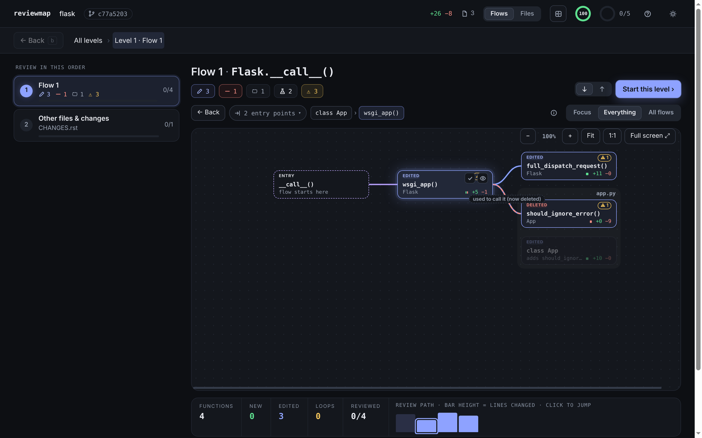
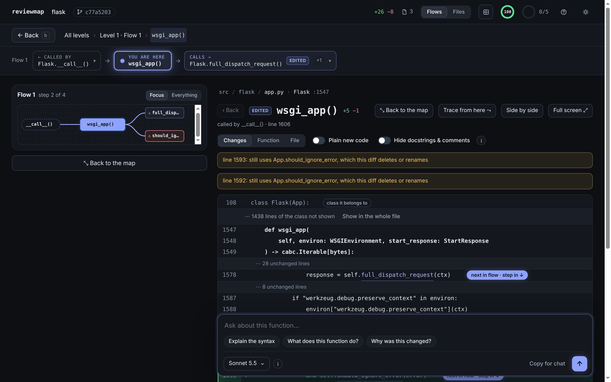
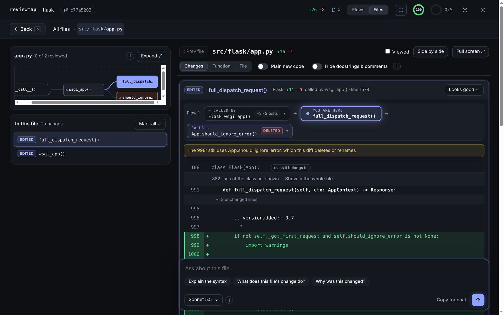

# reviewmap

Review a code change by following its call graph, not by reading file after file.

reviewmap opens a local page that shows the functions a change touches as a map of who calls what. It then walks you through the code in the order it runs: start where the flow begins, step into each call, and see a changed definition before the code that uses it.

https://github.com/user-attachments/assets/4025f48d-03f1-48ed-b83e-cfbc21e39e0f



## Why

Reviewing my own AI-generated code before raising a PR (on top of reviewing other people's PRs) had become the bottleneck. Reading code still feels more natural to me than reading paragraphs of an AI's explanation of what it did, especially after a few iterations.

Most visualisation tools I found were prompt or skill files, so the walkthrough itself was AI-generated again. reviewmap is a plain Python script plus an HTML page. It parses your code (no AI involved) and builds the map from that.

## What you get

- **Flows**: the change grouped into call paths, each shown as a map. Click a box to read its code.
- **Review order**: start at the entry point and step into each call, like a debugger. You see changed definitions before the code that uses them.
- **Files mode**: the same map and walkthrough, organised file by file, if you prefer that.
- **Things to check**: calls it can't resolve, and calls made inside loops, are flagged on the map.
- **Click any name** to peek at its definition and where it's used, then jump to the exact line.
- **Ask about the code** (optional): select a few lines and ask a question without leaving the page. The answer appears right under those lines. This uses your own Claude Code login. Or copy the code and question for a Claude chat in one click.
- **Full diff** of every file, the way a pull request shows it.
- **Trace mode**: understand one function end to end, even with no change.

### Screenshots

Taken on a real [Flask](https://github.com/pallets/flask) change ([c77a520](https://github.com/pallets/flask/commit/c77a5203), "deprecate should_ignore_error").

**The flow as a map.** The deleted method shows up in red, along with the call that used to reach it:


**One function in the walkthrough.** Where it sits in the flow, its changed lines, a "step in" marker on the next call, and a warning where it still uses something this change deletes:



**Files mode.** The same walkthrough, file by file:



## Requirements

- Python 3.9+ and git
- Optional: [`gh`](https://cli.github.com/), to review GitHub PRs by number
- Optional: [Claude Code](https://docs.claude.com/en/docs/claude-code/overview) (`claude`), for "Ask here"

There's nothing to install. It's a single file using only the Python standard library.

## Install

There's nothing to install. reviewmap is a single Python file that uses only the standard library.

**1. Download it**

Either:
- **From the browser:** open [`reviewmap.py`](reviewmap.py) above and click the **Download raw file** button (the ↓ icon at the top right of the file). Or grab it from the [latest release](../../releases/latest).
- **From the terminal:**
  ```sh
  curl -O https://raw.githubusercontent.com/<you>/reviewmap/main/reviewmap.py
  ```

**2. Run it** from inside the git repo you want to look at. Pick what you want to see:

```sh
# Your branch: everything it changes compared to main,
# both committed and not yet committed
python3 /path/to/reviewmap.py --base main

# Two branches or commits, e.g. a teammate's branch
python3 /path/to/reviewmap.py --base main --head their-branch

# A GitHub pull request (needs the gh CLI)
python3 /path/to/reviewmap.py --pr 123

# No change at all: understand how one function works end to end
python3 /path/to/reviewmap.py --trace Class.method
```

Reviewing needs a difference to show. If you're on `main` with nothing changed, `--base main` finds nothing. Switch to a branch with changes, pass `--head`/`--pr`, or use `--trace`, which works on any code.

It opens your browser with a link ending in `?t=…`. Use that exact link: typing the address by hand won't work.

**3. Optional: make it a `reviewmap` command** so you can run it from anywhere:

```sh
chmod +x reviewmap.py
mkdir -p ~/.local/bin
mv reviewmap.py ~/.local/bin/reviewmap
```

If `~/.local/bin` isn't on your PATH yet (macOS usually doesn't have it), add it once:

```sh
echo 'export PATH="$HOME/.local/bin:$PATH"' >> ~/.zshrc && source ~/.zshrc
```

Now, in any repo:

```sh
reviewmap --base main
reviewmap --trace Class.method
```

To update later, download the file again over the old one.

On Windows, skip step 3 and run `python reviewmap.py …`.

## Usage

Run it from inside the git repo you want to review:

```sh
python3 reviewmap.py                        # your uncommitted changes vs the main branch
python3 reviewmap.py --base main            # the current branch vs main
python3 reviewmap.py --base main --head feature-x
python3 reviewmap.py --pr 123               # a GitHub PR (needs gh)
python3 reviewmap.py --trace Billing.charge # one function end to end
python3 reviewmap.py --static --out review.html   # a single HTML file, no server (no "Ask here")
```

It opens your browser at a link like `http://127.0.0.1:PORT/?t=…`. **Use that exact link.** The `t` part is a one-time key, so typing `127.0.0.1:PORT` by hand won't work. If the browser doesn't open, copy the link from the terminal. If you restart reviewmap, use the new link.

Run `python3 reviewmap.py --help` for every option. Useful ones:

| Option | What it does |
|---|---|
| `--exact` | diff the two refs directly, not from their merge-base |
| `--intent FILE` | a note on what the change is for, shown alongside the review |
| `--chat URL` | link to the Claude chat that built the change; "Ask in chat" opens it |
| `--trace FUNC --until OTHER` | only the call paths between two functions |
| `--ask-model`, `--syntax-model` | which Claude models "Ask here" uses |

## Privacy and security

- Everything runs on your machine. The server listens on `127.0.0.1` only and needs the key from the link.
- **Your code goes nowhere unless you use "Ask here".** Then the code you selected and your question go to Claude through your own Claude Code login. That session is read-only: it can only read and search files in this repo, with no shell, no edits, no web access and no MCP servers, and it ignores the reviewed repo's own `.claude` settings.
- "Copy for chat" only copies to your clipboard.
- The HTML page has a strict Content-Security-Policy. Files reviewmap writes (`--static`, `--json`) are readable by you only.

## Limits

- **Python only** for the call graph and walkthrough. Every other file still appears in the full diff.
- The call graph comes from static analysis. Dynamic calls (`getattr`, dependency injection, signals) can't always be resolved, so reviewmap flags them instead of guessing.
- It's young and I've been iterating on it fast, so expect some bugs. Issues and PRs are welcome.

## License

[MIT](LICENSE)
